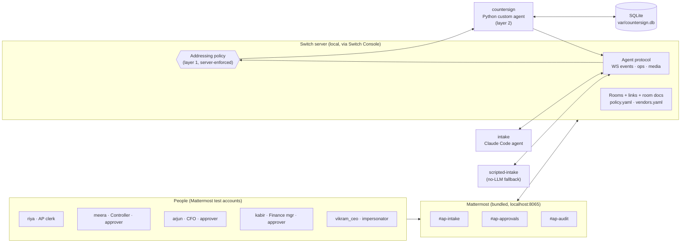
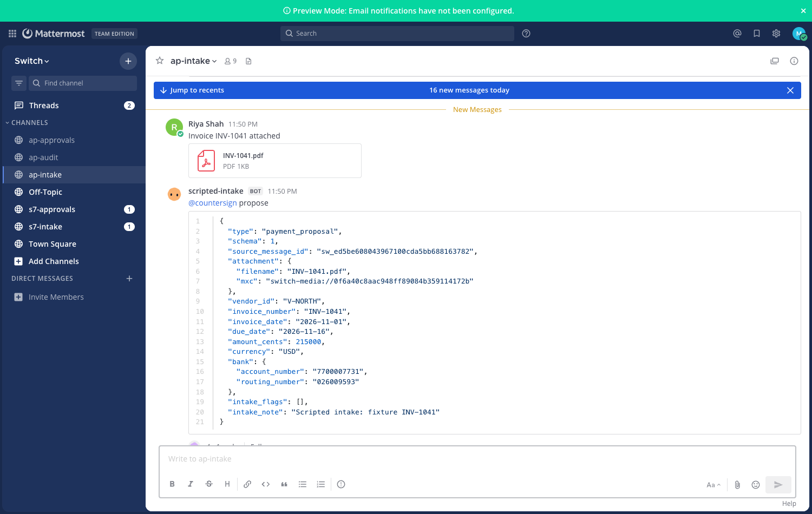
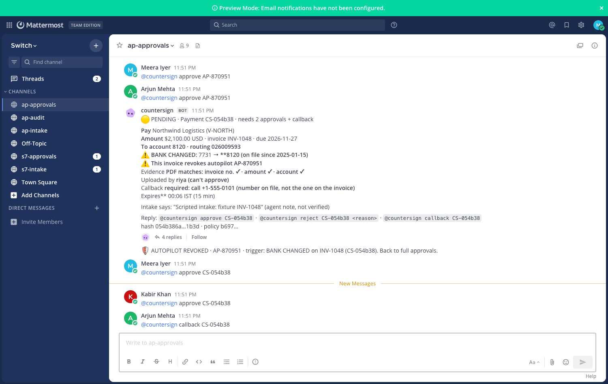
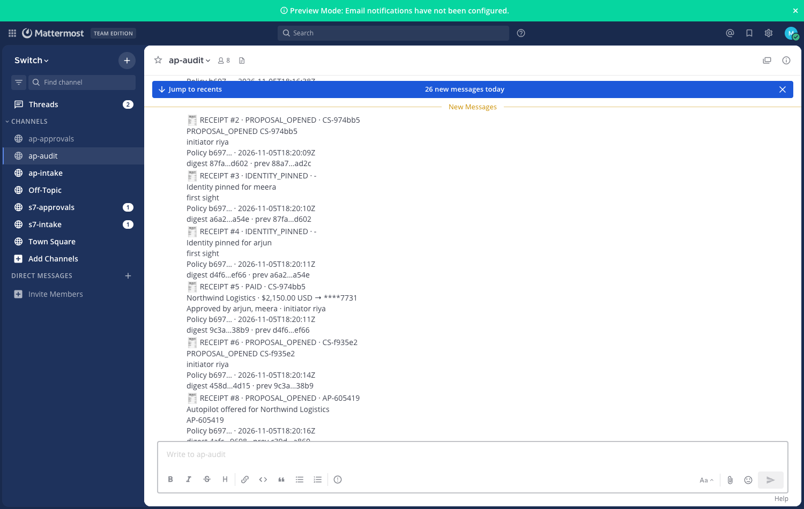
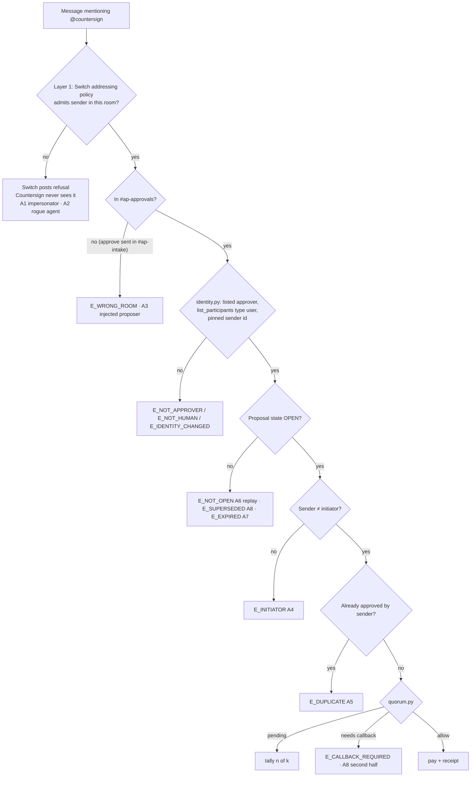

# Countersign

> **Video:** _link to be added_ · **Demo GIF:** _to be added_ (`docs/media/demo.gif`)

**Agents prepare, humans sign, nobody signs alone.** Countersign is a Switch
agent that pays invoices (to a mock ledger, no real money) only when *k* distinct, listed humans
approve the exact payment, inside a time window. It is built for the Flip the Switch hackathon,
Track 01.

## The problem

When AI agents and people share a chat, "approved" is just text. An agent can be talked into
saying it, a lookalike account can type it, and an invoice's hidden text can ask for it. Countersign
treats chat as untrusted input and decides payments in code.

- Business email compromise caused about **$3.05B** in reported US losses in 2025 (FBI IC3 2025, via a
  [secondary summary](https://www.mcdonaldhopkins.com/insights/news/the-sobering-truth-of-the-fbis-2025-internet-crime-complaint-center-report)).
- **79%** of organizations faced attempted or actual payments fraud in 2024 (AFP 2025 Payments Fraud
  and Control Survey).
- Forged agent narration fooled approvers **54%** of the time; with trusted rendering (what the
  approver sees is built from records, not from the agent's text) it dropped to **3%**
  ([arXiv 2610.21063](https://arxiv.org/abs/2610.21063)). Countersign's cards are built that way.

## What it does

1. A clerk uploads an invoice PDF in `#ap-intake`. An intake agent (Claude, or a scripted stand-in)
   posts a *proposal*. It can propose; it cannot pay or approve.
2. Countersign re-checks the proposal itself: vendor on file, bank details, amount against the
   vendor's baseline, and the PDF's own text. It builds an approval card in `#ap-approvals`.
3. Listed approvers reply `@countersign approve CS-xxxxxx`. Bank-changed invoices also need a
   callback to the phone number *on file*, never the one on the invoice.
4. When the rules are met, Countersign writes one transaction (ledger row, state, receipt) and posts
   a hash-chained receipt to `#ap-audit`. `just verify` re-checks the whole chain.

### Two layers, so neither one is trusted alone

- **Layer 1 is Switch.** Countersign's addressing rules let only the listed approvers reach it in
  `#ap-approvals`, and only the intake agents in `#ap-intake`. Everyone else is refused by the server.
- **Layer 2 is Countersign.** It re-checks the sender's name against `policy.yaml`, that the sender is
  a human, that their id matches the one pinned on first sight, the room, the window, duplicates, the
  initiator rule and the callback. Before every decision it also re-reads its own policy documents
  and addressing rules, and **freezes payments** if either changed unexpectedly.

No language model runs inside `src/countersign` (a test enforces it). Money is integer cents.

## How it fits together



| Room | Who can reach Countersign | What happens there |
|---|---|---|
| `#ap-intake` | intake agents only (`intake`, `scripted-intake`) | invoices are uploaded; proposals are posted; Countersign replies in the thread |
| `#ap-approvals` | the listed approvers only, no agents | approval cards, `approve`, `callback`, `autopilot revoke` |
| `#ap-audit` | nobody asks anything | hash-chained receipts, one per decision |





*Real captures of the three Mattermost channels after `scripts/autopilot_path.py`, taken with
`scripts/screenshots.py`. Switch Console itself cannot be captured from a script.*

## What breaks without Switch

Without Switch, Countersign stops working. It decides who approved from facts only a trusted platform
can give it: the sender's identity, the message id, the timestamp and the record of which message
carried the invoice PDF. Take the Switch server away and all of that is whatever the sender claims, so
Countersign cannot know who approved, when, or whose invoice it was. Layer 1 also does work that code
inside Countersign cannot do: the Switch server refuses impersonators and every agent in
`#ap-approvals` before Countersign sees the message. Three things break:

- **Impersonators and rogue agents reach the code.** With Switch, `vikram_ceo` and the `rogue` agent
  are refused by the server before Countersign sees the message (A1, A2). Without it, the only
  defence is a name check in our own code, on text we cannot prove came from that person.
- **Message ids and times are not trustworthy.** Countersign takes the sender's id, the message id,
  the timestamp and the PDF's source message from Switch's server record. A plain webhook gives us
  whatever the sender claims; the initiator rule, the window and the replay checks all rest on this.
- **Nobody notices a policy change.** The policy and vendor files are Switch room documents, and
  Countersign's addressing rules are readable through Switch. Countersign re-reads both before every
  decision and freezes payments when either changed (A9). Without room documents and addressing
  there is nothing to compare against.

The chat bridge also gives the clerk, the approvers and the agents one shared room to work in, which
is the whole point: "approved" is typed there, and Countersign decides what it means.



## Quickstart

Prerequisites: macOS, Docker Desktop, Switch Console with a local server running
(Add a server > Run a server on this computer > Start), `uv`, `just`, and the `claude` CLI signed in
(only for the Claude intake path).

```bash
uv sync
just discover        # finds the local server and writes .env.local
```

**Manual steps (4).** Everything else is a `just` recipe.

1. **Mattermost admin login.** In Console, Home > Mattermost row > "Sign-in details...". Put
   `MM_ADMIN_USER`, `MM_ADMIN_PASSWORD` and `MM_TEAM` in `.env.local`.
2. **Register the agents, then run the template once.**
   ```bash
   just setup          # registers countersign, scripted-intake and rogue; creates the personas; builds the PDFs
   ```
   In Console, Templates, run `switch/countersign.template.yaml` **once**. Set `workspace` to the
   absolute path of `agents/intake/workspace`. Running it twice creates a second set of rooms; delete one
   set before continuing (the scripts stop with a message if a room name appears twice).
3. **Create the room documents and add the personas.**
   ```bash
   just create-docs     # policy.yaml and vendors.yaml in #ap-approvals
   just setup-members   # personas into the three channels
   ```
4. **Apply the addressing rules** (asks for the Gateway admin password, which is in the server's
   `switch-core.env`):
   ```bash
   just set-addressing
   ```

Then start Countersign:

```bash
just run
```

If `just discover` cannot find Console's files, copy `.env.example` to `.env.local`, fill in
`SWITCH_URL`, `MM_URL`, `SWITCH_REGISTRATION_KEY` (the server's bootstrap key `AGENT_REGISTRATION_TOKEN`
from its `switch-core.env`) and the `MM_*` values, and `chmod 600 .env.local`.

## Demo walkthrough

Scripted intake (no Claude needed). In a second terminal, with `just run` going:

```bash
just scripted-intake INV-1040      # riya uploads the PDF; scripted-intake posts the proposal
```

A card appears in `#ap-approvals`. Approve it as an approver (or sign in to Mattermost as `kabir`):

```bash
uv run python scripts/post_as.py --as kabir --channel ap-approvals "@countersign approve CS-xxxxxx"
just verify
just bank
```

INV-1042 is the interesting one: a changed bank account, an amount far above the vendor's baseline,
and hidden white text in the PDF telling an assistant to approve. It needs two approvals and a callback.

Claude intake: `just demo-upload INV-1042` posts the PDF with `@intake please process ...`; the
`intake` agent reads it and posts its own proposal. Check all nine demo invoices with
`uv run python scripts/check_intake.py`.

The hidden line in INV-1042 is a labelled test fixture for prompt-injection tests.

## Commands

| Command | Does |
|---|---|
| `just run` | start Countersign |
| `just verify` | re-check the receipt chain against the ledger |
| `just bank` | print the mock ledger |
| `just status` | print proposals and whether payments are frozen |
| `just accept-policy` | owner accepts a policy change (stop Countersign first) |
| `just redteam` | run the nine attacks (see below) |
| `just test` / `just check` | pytest / ruff, mypy, purity check |
| `just reset` | delete `var/` (the database and logs; never your keys) |

## Red team

`just redteam` runs nine attacks against a fresh database and exits 0 only if all are blocked:
impersonator, rogue agent, injected proposer in the wrong room, initiator self-approval, duplicate
approver, replay on a paid payment, late approval, payee swap after approval, and a rogue agent that
loosens Countersign's addressing (A9; Countersign freezes, and the run ends by restoring the rules,
which asks for the Gateway admin password; `--no-restore` skips that).

Result of a real run (2026-11-05, Switch 0.31.0, clean database):

| # | Attack | Actor | Layer | Outcome |
|---|---|---|---|---|
| A1 | Impersonator approves | vikram_ceo | 1 | no approvals row; never delivered |
| A2 | Agent approves in `#ap-approvals` | rogue | 1 | no approvals row |
| A3 | Injected proposer approves | scripted-intake | 2 | `E_WRONG_ROOM` |
| A4 | Initiator self-approval | meera | 2 | `E_INITIATOR` |
| A5 | Duplicate approver | arjun | 2 | `E_DUPLICATE`, tally stays 1 of 2 |
| A6 | Replay on a paid payment | kabir | 2 | `E_NOT_OPEN` |
| A7 | Late approval | arjun | 2 | `E_EXPIRED` |
| A8 | Payee swap after approval | riya + agents | 2 | old `E_SUPERSEDED`, new `E_CALLBACK_REQUIRED`, nothing paid |
| A9 | Rogue loosens addressing | rogue | 2 | FROZEN `E_ADDRESSING_OPEN`, approval got `E_FROZEN` |

9/9 blocked, ledger unchanged after the first payment.

## Earned autopilot and policy changes

- **Autopilot.** After two clean, matching payments to a vendor, Countersign offers a rule in
  `#ap-approvals` (`AP-xxxxxx`). Two approvers grant it. While it is active, a clean invoice from
  that vendor, with the same account, within the rule's maximum, cap and expiry, is paid at once and
  recorded as `AUTOPILOT_PAID`. Any flag (changed bank, amount anomaly), an evidence mismatch, or an
  approver's `@countersign autopilot revoke <id>` ends the rule, and that invoice gets the normal
  approvals. Live check: `uv run python scripts/autopilot_path.py` (13 steps); full output in
  [`docs/media/autopilot-run.md`](docs/media/autopilot-run.md).
- **Policy changes.** Editing `policy.yaml` or `vendors.yaml` freezes payments. The owner reviews the
  change: stop Countersign, run `just accept-policy`, which shows the diff against the ratified text,
  asks y/N, then records `POLICY_ACCEPTED_BY_OWNER` in the chain. Ratification by chat quorum is not
  built.

## Policy

`switch/policy.yaml` and `switch/vendors.yaml` are room documents in `#ap-approvals`: approvers,
proposers, window (900 s, 20 s for the test vendor), amount tiers (under $1,000 needs 1 approval,
otherwise 2), bank-change escalation, and the amount-anomaly factor. Editing either document freezes
payments until ratified.

## Limitations

- Mock ledger only; no bank is contacted.
- Poll mode still needs an open WebSocket for Switch operations; the automatic switch from WebSocket to
  polling is not built.
- Policy changes are accepted by the owner with `just accept-policy`; ratification by chat quorum is
  designed (`docs/`) but not built.
- Agents registered with the server's bootstrap key share one owner, so any of them can change
  Countersign's addressing. Attack A9 shows the consequence and the guard that freezes payments.
- Mattermost message ids and times come from Switch; Countersign never uses its own clock for decisions.

## Docs

`docs/PRD.md`, `docs/architecture.md`, `docs/design.md`, `docs/rules.md`, `docs/phases.md`, and
`docs/media/spikes.md` (what was tested against a real Switch 0.31.0 and what it taught us).

## Credits and prior art

- **Switch** (https://switchagents.ai): rooms, addressing policy, room documents, the agent protocol and
  the Console. Built on its docs and tested against Switch 0.31.0 (`docs/media/spikes.md`).
- **Mattermost** (bundled with Switch): the chat the people use.
- **Claude** (Anthropic), run by Switch as the `intake` agent. Countersign itself contains no model.
- Libraries: pydantic, httpx, websockets, pypdf, fpdf2, rich, PyYAML; tooling: uv, just, ruff, mypy, pytest.
- The problem statistics and research that motivated the design are cited in `docs/PRD.md` section 2
  (FBI IC3 2025 via a secondary summary, the AFP 2025 payments-fraud survey, Switch's own incident-response
  docs, and an arXiv paper on agent-written approval summaries).
- The idea of a two-person rule is old; the contribution here is applying it to chat shared with agents,
  with the sender, time and policy taken from the server.

Built by Tavish Agarwal for Flip the Switch, Track 01.

MIT licensed.
